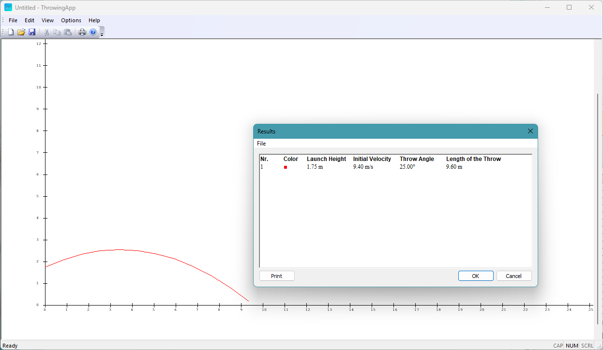

# ThrowingApp

ThrowingApp is a Windows desktop application for modeling throwing trajectories in sports and engineering-style analysis. It allows users to define a launch height, initial velocity, and throwing angle, then visualize the projectile path and review the computed flight distance.

## Project overview

The application is built with Microsoft Foundation Classes (MFC) and is intended for rapid trajectory analysis based on a simple physics model. It provides a clear plotting view, result summaries, and parameter estimation utilities for common shot-put-like calculations.

## Features

- Visual trajectory plotting for projectile motion
- Adjustable launch height, initial velocity, and angle
- Multiple throw results with color-coded entries
- Parameter estimation for angle and initial velocity
- Results dialog for review and printing
- Windows desktop help integrated with the CHM help system
- Installer package for deployment on supported Windows systems

## Supported operating systems

- Windows 10 x64
- Windows 11 x64

## Build instructions

### Prerequisites

- Microsoft Visual Studio 2022 or later
- C++ desktop development workload with MFC support
- Windows 10/11 SDK
- HTML Help Workshop for CHM generation (optional for package generation)
- Inno Setup 6 for packaging (optional for installer generation)

### Build the solution

1. Open `ThrowingApp.sln` in Visual Studio.
2. Select a configuration such as `Debug` or `Release` and target `x64`.
3. Build the solution.
4. Alternatively, from a Developer Command Prompt:

   `msbuild ThrowingApp.sln /m /p:Configuration=Release /p:Platform=x64`

## Dependencies

- Microsoft Foundation Classes (MFC)
- Windows SDK
- HTML Help Workshop for generating `ThrowingApp.chm`
- Inno Setup 6 for creating the installer package

## Licensing

This repository does not currently include a formal license file. Before redistributing or commercializing the project, confirm the appropriate licensing terms with the project owner. Update this section when a repository license is added.

## Screenshots

## Documentation

- CHM help: `Help/ThrowingApp.chm`
- HTML help pages: `Help/index.html`
- Help index: `Help/Table of Contents.hhc`

## Troubleshooting

- If the build fails, confirm that the MFC desktop workload is installed.
- If the CHM help file does not build, install HTML Help Workshop and ensure the project file references valid HTML pages.
- If the installer fails, confirm that Inno Setup is installed and that the output paths in `ThrowingAppSetup.iss` exist.

## Contribution guidelines

1. Keep changes focused and documented.
2. Rebuild the solution after code changes.
3. Validate the CHM help pages and README for completeness.
4. Avoid changing public data formats, file layouts, or keyboard behavior without a clear defect-driven reason.
5. Keep commits descriptive and focused on a single change set.

## Packaging

The installer script is defined in `ThrowingAppSetup.iss`. It produces a Windows installer bundle for the application and distributes the help files.

## Contact and support

For issues and enhancement requests, use the project repository and issue tracker.
